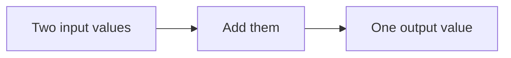

---
theme:
  override:
    mermaid:
      theme: dark
      background: transparent
---

A tiny display check
===================

This is a synthetic example. It contains no learning records.



```latex +render +width:45%
\[
y = x_1 + x_2
\]
```

Given: x₁ = 2 and x₂ = 3.

**What is y?**
