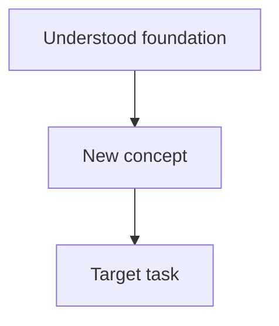

# <Topic>: Learning Plan

Replace placeholders when creating a topic. Record only actual goals, plans, and evidence.

## Goal and scope

- Purpose: <What this learning is for>
- Completion criterion: <A task I can independently perform>
- Included scope: <Material covered in this round>
- Outside this round: <Material the goal does not require>
- Plan approval: Awaiting approval
- Last updated: <YYYY-MM-DD>

## Assessment

| Strand | Existing ability and evidence | Gaps or missing evidence |
| --- | --- | --- |
| <Relevant prerequisite> | <Actual question and answer performance> | <Specific gap or unconfirmed ability> |

## Teaching order

<Briefly explain the sequence and why it suits the goal and existing knowledge.>

## Dependency graph

This is a format example. Replace it with actual nodes and dependencies.

## Nodes and evidence

Statuses: To assess, To learn, In progress, Passed in session, Passed on review. Record independent success separately from success with hints. Preserve previous evidence when a failed review changes a status.

| ID | Node | Dependencies | Status | Session evidence and date | Later review evidence and date |
| --- | --- | --- | --- | --- | --- |
| N1 | Understood foundation | None | To assess | None yet | None yet |
| N2 | New concept | N1 | To learn | None yet | None yet |
| N3 | Target task | N2 | To learn | None yet | None yet |

## Key sources

<Record source links, supported claims, applicable conditions, or versions when needed. Clearly mark unverified material.>
